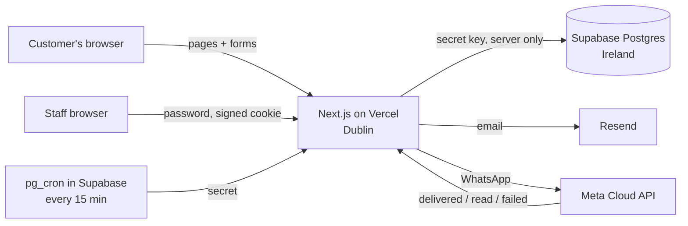

# Maison Adé

A booking app for a **made-up** luxury hair and beauty salon in Lekki, Lagos. Customers pick a service, a stylist and a
free time, then get confirmations and reminders by **email** and **WhatsApp**. Staff get a password-protected diary.

**Live demo:** https://maison-ade.vercel.app · Everything (names, prices, phone numbers) is demo data.

Built as a portfolio project on scheduling, workflows and notifications.

---

## What it does

**Customers**
- Book in four steps: service → stylist (or "any stylist") → day and time → name and phone. No account needed.
- Only times that really fit are offered: opening hours, the stylist's hours and days off, time off, existing
  bookings, at least 2 hours' notice, up to 60 days ahead, and the whole service must finish by closing.
- A private link to see, **change** or **cancel** the booking (online until 2 hours before), plus "Add to calendar".
- Confirmation, change and cancellation messages, and **reminders** the day before and 2 hours before, by email
  and/or WhatsApp (only the channels they tick).

**Staff** (`/staff`, shared salon password)
- Day view per stylist with every booking, phone (tap to call / WhatsApp) and status.
- Add or remove time off (it disappears from online booking straight away; warns about bookings already in that time).
- Cancel for a customer who phones in (the customer is told automatically).
- A message log: every email and WhatsApp, whether it was sent / delivered / read, the reason if not, and "Try again".

## How it works



Decisions worth knowing:

| Problem | How it's solved |
|---|---|
| Two people booking the same slot at the same moment | The **database** refuses overlapping bookings for a stylist (a Postgres exclusion constraint). The app can't get it wrong even under a race. |
| Showing only real free times | One pure, fully tested function (`src/lib/availability.js`): opening hours ∩ stylist hours − time off − bookings − notice rules. |
| Messages sent twice | Every message is logged **before** sending; the database allows one per booking + channel + kind + time; sending "claims" a message so only one worker can send it; email uses an idempotency key; an interrupted WhatsApp is never retried. |
| Messages slowing booking down | They're sent just after the page responds (`after()`), so booking never waits for email or WhatsApp. |
| Reminders every 15 minutes on Vercel's free plan (which only allows daily jobs) | Supabase's `pg_cron` calls a secret-protected address on the site every 15 minutes. |
| Stale messages | A reminder is never sent for a booking that was cancelled, moved, or has already started. |
| Customer accounts | Deliberately none: sign-up forms cost bookings. The private link (an unguessable 256-bit code; the database only stores its hash) does the job of an account. |
| Times | All Lagos time (UTC+1, no daylight saving); stored as exact moments in the database. |

## Security

- **Database locked down:** the public Supabase roles have no permissions and Row Level Security is on with no rules.
  Only the server (secret key, never sent to browsers) can read or write. A test proves the public key is refused.
- **Every input checked on the server** (the browser is never trusted): ids, dates, times, names, phones, emails,
  and the chosen slot is re-checked at the moment of booking.
- **Abuse limits:** max 3 upcoming bookings per phone; max 5 bookings an hour from one place; a hidden "honeypot"
  field for bots. Staff login: 5 wrong passwords from one place, or 30 from everywhere, pause logins for 15 minutes.
- **Staff session:** signed, HTTP-only, SameSite=strict cookie for 12 hours; changing the password logs everyone out.
  Every staff page and action re-checks the login.
- **Private links** are unguessable, hidden from search engines and never passed on to other sites.
- **Headers:** Content Security Policy (only our own scripts, styles, fonts, images and forms), no framing,
  no sniffing, strict referrer, no camera/mic/location.
- **Webhook and reminder addresses** only accept requests signed with our secrets (constant-time checks).
- **Privacy:** visitor fingerprints for rate limits are one-way hashes and are deleted after 2 days.
- No secret has ever been committed (checked across the whole git history); `npm audit`: 0 known vulnerabilities.

Known limits: phone numbers aren't verified (anyone could book with someone else's number, within the limits above);
staff share one password (no per-person logins or audit of who did what).

## Run it yourself

Needs **Node 22**, a free **Supabase** project (pick a region near your Vercel region), and optionally **Resend**
and a **Meta** developer app for messages.

1. `npm install`
2. Copy `.env.example` to `.env.local` and fill it in (see below).
3. In Supabase → **SQL Editor**, run every file in `supabase/migrations/` **in order** (0001 → 0007).
   In 0006, replace `PASTE_CRON_SECRET_HERE` with your `CRON_SECRET` *in the editor only* (never commit it), and
   change the URL to your own site.
4. `npm run db:check` (connection) then `npm run db:seed` (copies services and stylists from `src/config/salon.js`).
5. `npm run dev` → http://localhost:3000

### Settings (`.env.local`, and the same in Vercel → Settings → Environment Variables)

| Name | What it is | Needed for |
|---|---|---|
| `SUPABASE_URL` | Supabase → Project Settings → API | everything |
| `SUPABASE_SECRET_KEY` | the **secret** key (`sb_secret_…`); server only | everything |
| `STAFF_PASSWORD` | the shared staff password (12+ characters) | `/staff` |
| `RESEND_API_KEY` | resend.com → API Keys | email |
| `EMAIL_FROM` | optional sender, needs a verified domain in Resend | email |
| `WHATSAPP_TOKEN` | Meta permanent (system user) token | WhatsApp |
| `WHATSAPP_PHONE_NUMBER_ID` | Meta → WhatsApp → API Setup | WhatsApp |
| `WHATSAPP_USE_TEMPLATES` | `on` once your templates are approved | WhatsApp to people who haven't written in 24h |
| `WHATSAPP_APP_SECRET` / `WHATSAPP_WEBHOOK_VERIFY_TOKEN` | delivery tracking webhook | Delivered / Read |
| `CRON_SECRET` | 32+ random characters; also stored in Supabase Vault | reminders |
| `SUPABASE_PUBLISHABLE_KEY` | public key, **tests only** (proves the lockdown) | `npm test` |

Without the message settings the app still works: messages are logged as "not sent: not set up".
WhatsApp setup (permanent token, the four templates with exact wording, webhook): **[docs/whatsapp-setup.md](docs/whatsapp-setup.md)**.

Vercel only picks up changed settings on a **new deploy**. `/api/health` shows ok / not ok (details when logged in as staff).

## Commands

| Command | What it does |
|---|---|
| `npm run dev` | local site on port 3000 |
| `npm test` | all unit and database tests (Node's test runner; database tests use made-up `+999` numbers and clean up) |
| `npm run test:e2e` | builds the site and clicks through it in a real browser (Playwright) |
| `npm run db:check` / `npm run db:seed` | check the connection / copy salon data into the database |
| `npm run msg:test -- <phone> <email>` | send one real test WhatsApp and/or email (`hello` first for Meta's hello_world template) |

## Project map

```
src/config/salon.js          services, prices (kobo), stylists, hours, booking rules: all DEMO data
src/lib/availability.js      the free-slot calculator (pure)
src/lib/schedule.js          loads a week from the database and asks the calculator
src/lib/booking.js           create, find by link, move, cancel
src/lib/booking-input.js     checking customer input (phones, names, emails)
src/lib/staff*.js, session.js, login-attempts.js   staff diary and login
src/lib/messages/            wording, Resend + WhatsApp senders, the outbox, the WhatsApp webhook parser
src/lib/reminders.js         what the 15-minute clock does
src/app/                     pages: / · /book · /b/[link] · /staff · api/cron · api/webhooks · api/health
supabase/migrations/         the database, step by step
tests/  e2e/                 unit + database tests, browser tests
```

## Possible next steps

- **"Find my bookings":** enter your phone, get a one-time code on WhatsApp, see all your bookings (no passwords).
- **Per-stylist logins** with each person seeing their own diary, and a record of who changed what.
- A real WhatsApp business number and an email domain, so messages reach any customer.
- Deposits for long services (e.g. Paystack), to reduce no-shows.
